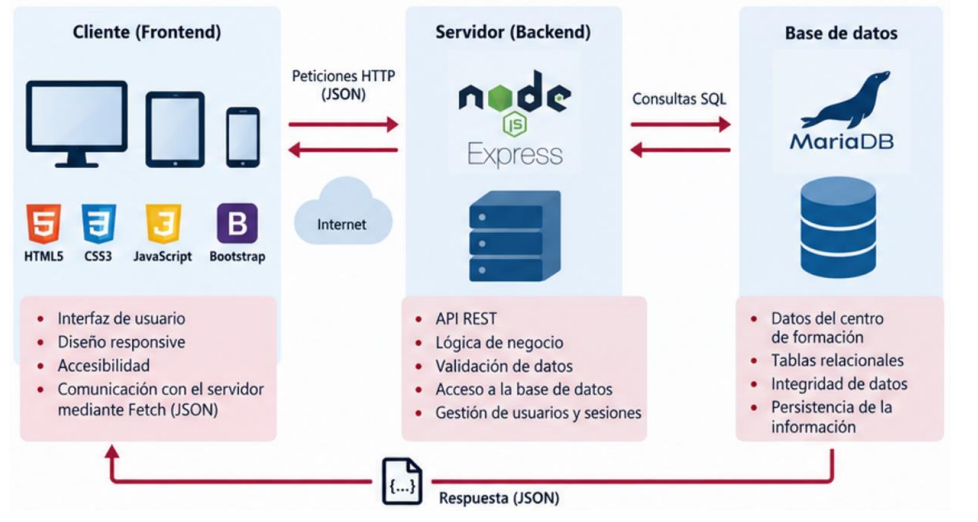
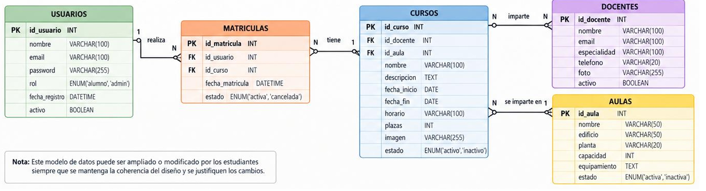
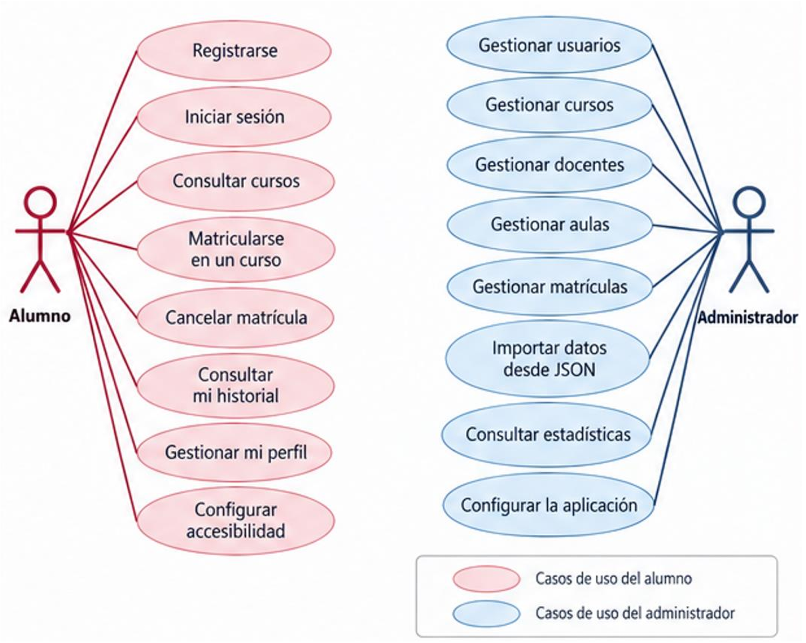

# Índice
1. [Descripción](#1-descripción)
   
   1.1. [Arquitectura](#11-arquitectura)
   
   1.2. [Entorno](#12-entorno)
   
2. [Base de Datos](#2-base-de-datos)
3. [Usuarios](#3-usuarios)

   4.1. [Alumno](#31-alumno)
   
   4.2. [Administrador](#32-administrador)
   
4. [Diseño de la interfaz](#4-diseño-de-la-interfaz)
5. [Evaluación y Entrega](#5-evaluación-y-entrega)

# 1. Descripción
La aplicación simulará el funcionamiento de un **centro de formación**, que gestiona:
1. Cursos
2. Docentes
3. Aulas
4. Alumnos

Los alumnos podrán matricularse en los cursos ofertados y consultar su historial de matriculas. Los administradores, tendrán un panel de gestión con la información del centro, gestión de cursos, docentes, aulas y alumnos, y las estadísticas.

## 1.1. Arquitectura
Se basa en la arquitectura **cliente-servidor** donde hay 3 partes: Frontend, Backend y Base de Datos. En este caso usaremos las siguientes tecnologías:
Frontend:
- HTML
- CSS
- JS
- Bootstrap 5 (Framework de CSS)

Backend:
- node.js
- Express 5 (Framework de node)

Base de datos:
- MariaDB

## 1.2. Entorno
Para poder realizar el proyecto se deberá preparar las siguientes aplicaciones:
- [VSCode](https://code.visualstudio.com/): El editor de texto. Extensiones recomendadas:
  - Live Server
  - ErrorLens
  - GitGraph
  - CSS Peak
- [XAMPP](https://www.apachefriends.org/es/index.html): Se en carga de abrir los puertos de la página y de la Base de Datos.

# 2. Base de Datos
Usaremos MariaDB, se nos dará un script SQL (aw_practica.sql) par a la creación de la BD y unos ficheros JSON con datos básicos. El diagrama de entidad relación sería:

> [!IMPORTANT] Datos importantes sobre el modelo E/R son las relaciones donde tenemos que:
> - Un **Docente** puede impartir varios **Cursos** 
> - Un **Curso** impartido por 1 solo **Docente**
> - Un **Aula** podrá usarse por varios **Cursos**
> - Un **Curso** solo se imparte en 1 **Aula**
> - Un **Alumno** pude matricularse en varios **Cursos**
> - Un **Curso** pude teber varios **Alumnos**

> [!IMPORTANT] Tambien hay que saber que:
> - Un **Usuario** no podrá matricularse más de 1 vez en un **Curso**
> - No se podrá superar las plazas de un **Curso**
> - No se podrá eliminar a **Docentes** asociados a un **Curso**
> - No se podrán eliminar **Aulas** asociados a **Cursos** activos
> - **Matriculas** canceladas permanecen en el histórico
> - Los **Usuarios** inactivos no puden iniciar sesión

# 3. Usuarios
La página web va a tener 2 usuarios, **alumnos** y **administradores**.

## 3.1. Alumno
Los alumnos son cualquier usuario que se registre, es el que consultara la oferta. Debe poder hacer:

- [ ] Registrarse
- [ ] Iniciar sesión
- [ ] Listar cursos
- [ ] Buscar y filtrar cursos
- [ ] Ver cursos
- [ ] Matricularse en un curso
- [ ] Cancelar una matricula
- [ ] Historial de cursos (Tanto activos como históricos)
- [ ] Modificar perfil
- [ ] Accesibilidad

## 3.2. Administrador
El administrador tendrá acceso completo a la plataforma, pudiendo hacer **todas las funciones del alumno** (es decir, un administrador tambien es alumno) y tambien:

- [ ] Gestionar cursos
- [ ] Gestionar docentes
- [ ] Gestionar aulas
- [ ] Gestionar usuarios
- [ ] Gestionar matrículas
- [ ] Importar JSONs o datos
- [ ] Estadísticas
- [ ] Configurar parametros de la aplicación

# 4. Diseño de la interfaz
Para marcar bien el diseño tendremos 3 partes en todas las páginas de la web:
1. Barra de navegación (`<header>` con un `<nav>` dentro)
2. Zona principal (`<main>`)
3. Pie de página (`<footer>`)

Como se ha mencionado antes se usará Boostrap 5 para facilitar el desarrollo del frontend.
Las páginas **públicas** serán:
- Inicio
- Login
- Sign up

Las páginas de **alumnos** mínimas son:
- Cursos
- Detalle de curso
- Mis matrículas
- Perfil

Las páginas mínimas de **administrador** son:
- Dashboard
- Gestión de cursos, docentes, aulas, usuarios, matrículas
- Importación JSON
- Estadíticas

Todas estas páginas debentener un diseño responsive que pueda adaptar se a ordenadores, tablets y moviles.

## 4.1. Barra de navegación
Recuerda que esto estará arriba de la página será un `<header>` que dentro tiene un `<nav>`. Cuando el usuario no este inciado todos los botones Excepto inicio y login estarán ocultos. Como dato extra el profesor dijo de hacer una miga. Una vez iniciado sesión se debera ver:
- Inicio
- Cursos
- Docentes
- Aulas
- Mis matrículas
- Perfil (Puedes ponerlo donde el Cerrar sesión hacer lo como Youtube o similar)
- Accesibilidad
- Administración (Solo se ve para los Admninistradores)
- Cerrar sesión (no hace falta que este en el nav con el resto de elementos)

## 4.2. Panel de Alumno
Será lo primero que verá el usuario al iniciar sesión, muchos de estas funciones serán accesos rápidos a las páginas, debe contener:
- Consultar la oferta
- Buscar cursos
- Filtrar cursos
- Consultar detalle de curso
- Matricularse
- Cancelar matriculas
- Consulatar historial
- Editar perfil
- Accesibilidad

## 4.3. Panel de Administración
Será lo primero que verá el administrador, ya que una vez incie sesión irá directamente a la pestaña de administración:
- Cursos (Alta, Baja, Modificación y Consulata)
- Docentes (Alta, Baja, Modificación y Consulata)
- Aulas (Alta, Baja, Modificación y Consulata)
- Usuarios (Alta, Baja, Modificación y Consulata)
- Matriculas
  - Alta
  - Cancelación
  - Consulta
- Importar datos
  - Carga desde JSON
  - Actualizar datos existentes
- Estadísticas
  - Num cursos
  - Num alumnos
  - Num docentes
  - Ocupación de aulas
  - Curso con mayor num matriculas

# 5. Evaluación y entrega
La puntuación se distribuye entre:
<table>
    <tr>
        <th>Criterio</th>
        <th>%</th>
    </tr>
    <tr>
        <td>Funcionamiento</td>
        <td>35%</td>
    </tr>
    <tr>
        <td>Calidad técnica</td>
        <td>20%</td>
    </tr>
    <tr>
        <td>Diseño y usabilidad</td>
        <td>15%</td>
    </tr>
    <tr>
        <td>Accesibilidad</td>
        <td>10%</td>
    </tr>
    <tr>
        <td>Calidad del código</td>
        <td>10%</td>
    </tr>
    <tr>
        <td>Defensa</td>
        <td>10%</td>
    </tr>
</table>

Se entrgará como gXX_PO.zip donde el XX es el número del grupo del laboratorio. Y debe contener:
- Código fuente completo.  
- Base de datos y scripts SQL necesarios.  
- Archivos JSON utilizados.  
- Recursos gráficos.  
- Hojas de estilo CSS.  
- Código JavaScript.  
- Código del servidor.  
- Manual básico de instalación.
- Manual básico de usuario.

No se incluye **node_mnodules** ni ningun archivo proporcionado por el profesor.
